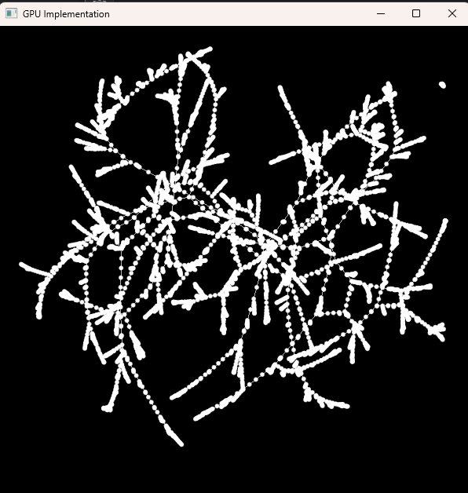

# Network Visualisation CUDA

CUDA/OpenGL force-directed graph visualisation for Windows. The app loads a graph, runs the layout on the GPU, and opens a GLFW/OpenGL window to draw the result.



## Requirements

- Windows x64
- NVIDIA GPU with a CUDA-capable driver
  - Tested on this machine with an NVIDIA GeForce RTX 3070 and NVIDIA GeForce 970
- Visual Studio 2022 with the C++ desktop workload
- CUDA Toolkit 11.6 with Visual Studio integration
- GLFW static library and headers
  - This repository already includes `Dependencies/GLFW/include` and `Dependencies/GLFW/lib-vc2019/glfw3.lib`

> Note: the Visual Studio project is configured for CUDA 11.6 and the Visual Studio 2022 `v143` toolset because those are installed on this machine. CUDA 11.6 is older than the current MSVC compiler, so the project also enables NVIDIA/MSVC compatibility overrides needed to build locally.
>
> CUDA code generation targets `compute_86,sm_86`, which matches the NVIDIA GeForce RTX 3070 Ampere architecture.

## Build

From the repository root:

```powershell
& "C:\Program Files\Microsoft Visual Studio\2022\Community\MSBuild\Current\Bin\MSBuild.exe" .\network-visualisation-gpu.sln -p:Configuration=Release -p:Platform=x64 -maxCpuCount
```

Debug builds are also available:

```powershell
& "C:\Program Files\Microsoft Visual Studio\2022\Community\MSBuild\Current\Bin\MSBuild.exe" .\network-visualisation-gpu.sln -p:Configuration=Debug -p:Platform=x64 -maxCpuCount
```

## Runtime notes

The layout loop launches all iteration kernels asynchronously and synchronizes once after the loop before reading results back to the CPU. This avoids a costly `cudaDeviceSynchronize()` after every iteration while still timing the full GPU workload.

Repulsive forces currently use shared-memory tiled all-pairs repulsion for all CLI modes. The earlier spatial-grid approximation was disabled because it degraded the final layout. Attractive forces use the graph edge list rather than scanning the full adjacency matrix.

## Run

Run the executable from the repository root so relative `Data` paths resolve correctly.

```powershell
.\x64\Release\network-visualisation-gpu.exe Data\SmallGraph.txt 100 exact
```

Mode argument example:

```powershell
.\x64\Release\network-visualisation-gpu.exe Data\5000Nodes.txt 1000 exact
```

Viewer controls:

- The graph is automatically fitted to the window when results are shown.
- Pan with `W/A/S/D`, arrow keys, or left-click drag.
- Hold `Shift` while using keyboard pan for faster movement.
- Zoom with the mouse wheel or `-` / `=`.
- Press `R` or `Home` to reset the camera.

Arguments for loading an existing graph:

```text
network-visualisation-gpu.exe [fileName] [iterations] [exact|grid|hybrid]
```

Repulsion modes:

- `exact` uses shared-memory tiled all-pairs repulsion.
- `grid` and `hybrid` are currently accepted for CLI compatibility, but they route through the exact repulsion path because the spatial-grid approximation degraded layouts badly.

If no mode is provided, the app defaults to `exact`.

Example datasets included in `Data/`:

- `Data/SmallGraph.txt`
- `Data/100Nodes.txt`
- `Data/1000Nodes.txt`
- `Data/5000Nodes.txt`

The graph file format is plain text:

```text
<number_of_nodes> <number_of_edges>
<source_node> <target_node>
<source_node> <target_node>
...
```

## GPU check

This reports the GPU, driver version, and CUDA driver capability. The CUDA Toolkit compiler version can be checked with:

```powershell
nvcc --version
```
